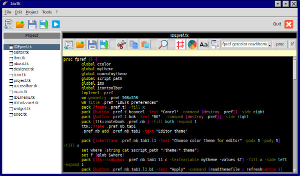
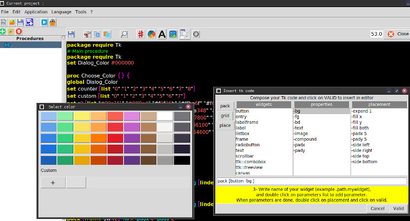

# IdeTK ,a pure tcl tk made IDE for tcl tk programming language.

# Description
IdeTK is an IDE to develop programs in tcl tk language with sqlite database to store code and procedures
This application has :
- color syntax.
- copy,paste,cut
- manage tcl procedure
- search and find
- themable color of editor

  Made in february 2025, i continu to develop it.
  Help is welcome ! ;-)
  More information on https://tcltk.fr/?ide

# Requirement 
Linux platform ( i did not try on windoor or applepie :) )
tcl and tk 8 minimum
tcl sqlite 
tkpng

# Download
[Direct link to last project (.zip)](https://github.com/FabienTon/idetk/archive/refs/heads/main.zip)

# screenshots

  
